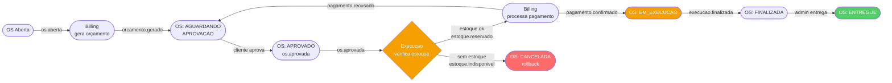
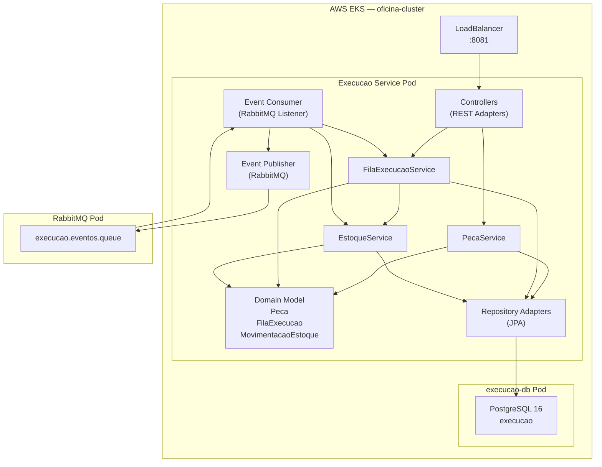
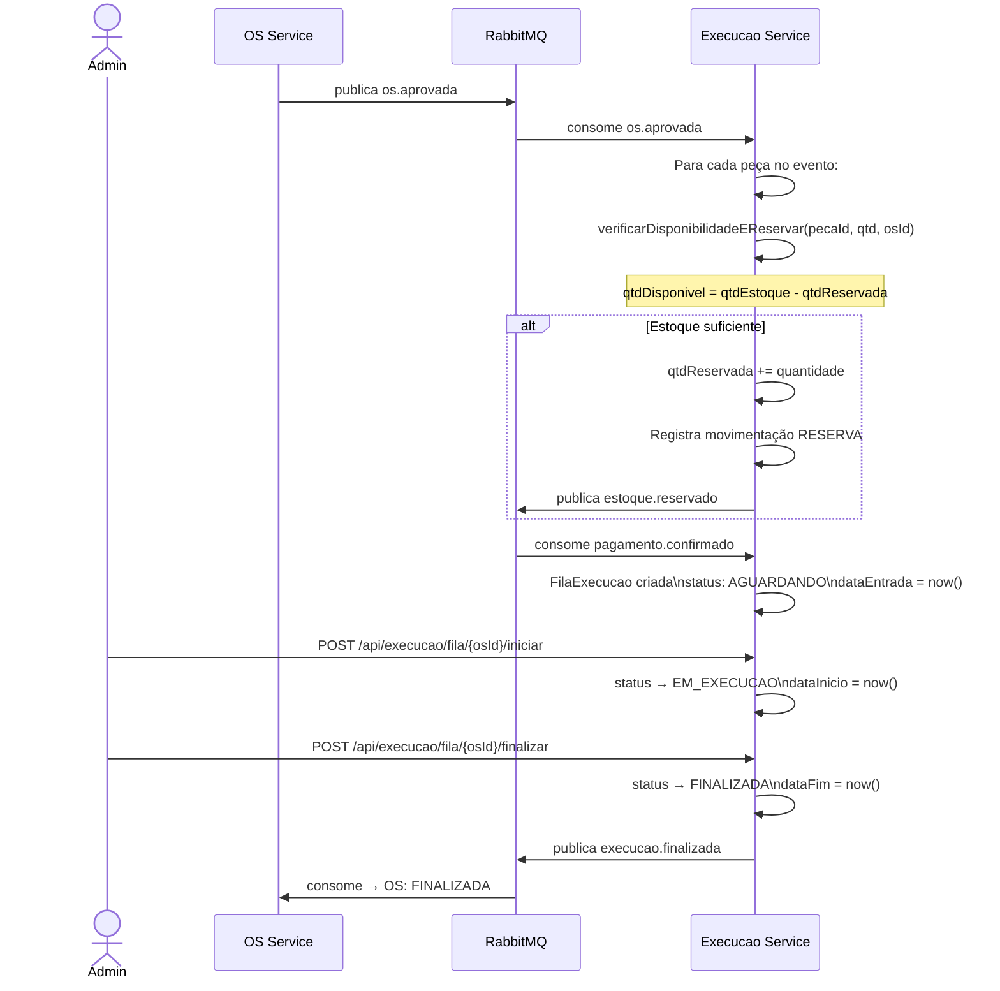
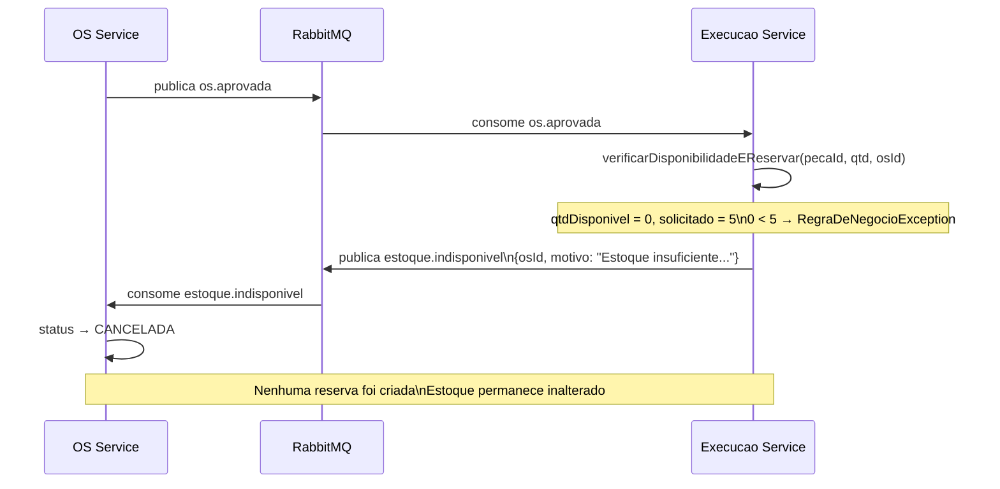
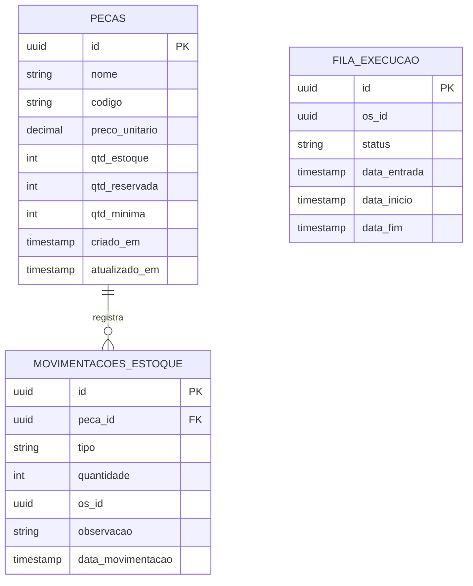
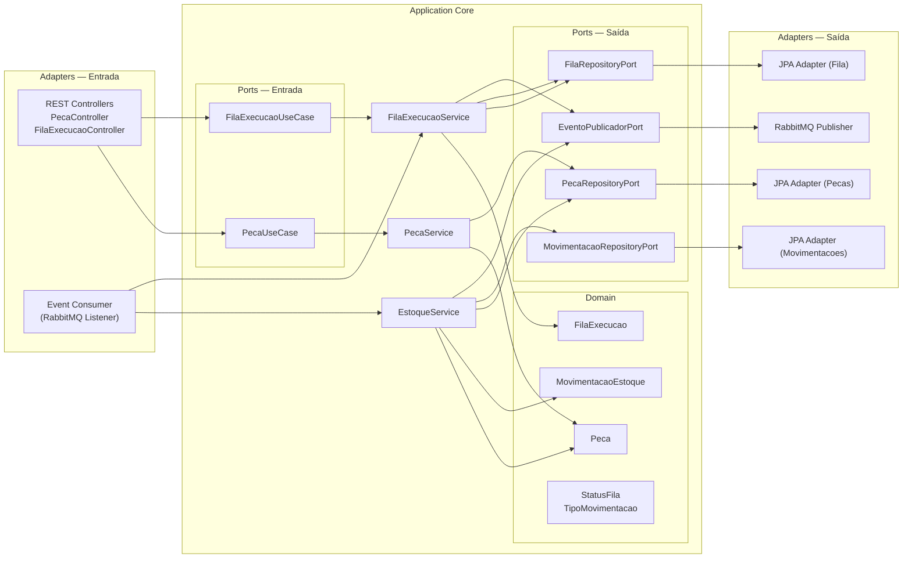
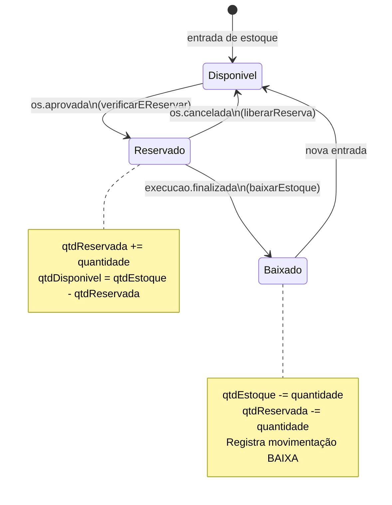

# Documentação de Arquitetura — Execucao Service
## FIAP Pós-Tech Software Architecture — Tech Challenge Fase 4

---

## Sumário

1. [Visão Geral do Serviço](#1-visão-geral-do-serviço)
2. [Arquitetura da Fase 4 — Microsserviços](#2-arquitetura-da-fase-4--microsserviços)
3. [Diagrama de Componentes do Serviço](#3-diagrama-de-componentes-do-serviço)
4. [Diagrama de Sequência — Saga Happy Path](#4-diagrama-de-sequência--saga-happy-path)
5. [Diagrama de Sequência — Saga Rollback](#5-diagrama-de-sequência--saga-rollback)
6. [Diagrama ER](#6-diagrama-er)
7. [Arquitetura Hexagonal](#7-arquitetura-hexagonal)
8. [Gestão de Estoque](#8-gestão-de-estoque)
9. [Eventos Publicados e Consumidos](#9-eventos-publicados-e-consumidos)
10. [Justificativa do Banco de Dados](#10-justificativa-do-banco-de-dados)
11. [ADRs](#11-adrs)

---

## 1. Visão Geral do Serviço

O **Execucao Service** gerencia o estoque de peças e a fila de execução das Ordens de Serviço. É o serviço que valida a viabilidade operacional de uma OS (disponibilidade de peças) e coordena a execução física dos serviços.

| Atributo | Valor |
|---|---|
| Linguagem | Java 17 |
| Framework | Spring Boot 3.5.3 |
| Banco de Dados | PostgreSQL 16 |
| Mensageria | RabbitMQ (produtor e consumidor) |
| Porta | 8081 |

### Responsabilidades

- CRUD de peças com controle de estoque (disponível, reservado, mínimo)
- Reserva e liberação de estoque para OSes
- Gestão da fila de execução (entrada, início, finalização)
- Publicação de `estoque.indisponivel` como mecanismo de rollback da Saga
- Publicação de `execucao.finalizada` para encerrar o fluxo da OS

---

## 2. Arquitetura da Fase 4 — Microsserviços

Diagrama completo da comunicação entre os 3 microsserviços via RabbitMQ (Exchange: `oficina.events`).

```mermaid
graph TB
    subgraph Cliente["Atores Externos"]
        ADM[Admin / Atendente]
        CLI[Cliente]
    end

    subgraph RMQ["RabbitMQ — oficina.events (Topic Exchange)"]
        direction LR
        E1([os.aberta])
        E2([os.aprovada])
        E3([os.cancelada])
        E4([orcamento.gerado])
        E5([pagamento.confirmado])
        E6([pagamento.recusado])
        E7([estoque.reservado])
        E8([estoque.indisponivel])
        E9([execucao.finalizada])
    end

    subgraph OS["OS Service — :8080\nPostgreSQL"]
        OS_API[REST API]
        OS_CON[Event Consumer]
        OS_PUB[Event Publisher]
    end

    subgraph BILLING["Billing Service — :8082\nMongoDB"]
        B_API[REST API]
        B_CON[Event Consumer]
        B_PUB[Event Publisher]
    end

    subgraph EXEC["Execucao Service — :8081\nPostgreSQL"]
        EX_API[REST API]
        EX_CON[Event Consumer]
        EX_PUB[Event Publisher]
    end

    ADM -->|JWT Bearer| OS_API
    CLI -->|endpoint público| OS_API
    ADM -->|JWT Bearer| EX_API

    OS_PUB -->|publica| E1
    OS_PUB -->|publica| E2
    OS_PUB -->|publica| E3

    E1 -->|consome| B_CON
    E2 -->|consome| EX_CON
    E3 -->|consome| EX_CON

    B_PUB -->|publica| E4
    B_PUB -->|publica| E5
    B_PUB -->|publica| E6

    E4 -->|consome| OS_CON
    E5 -->|consome| OS_CON
    E5 -->|consome| EX_CON
    E6 -->|consome| OS_CON

    EX_PUB -->|publica| E7
    EX_PUB -->|publica| E8
    EX_PUB -->|publica| E9

    E7 -->|consome| OS_CON
    E8 -->|consome| OS_CON
    E9 -->|consome| OS_CON
```



### Fluxo do Saga Pattern (Coreografado)



---

## 3. Diagrama de Componentes do Serviço



---

## 4. Diagrama de Sequência — Saga Happy Path



---

## 5. Diagrama de Sequência — Saga Rollback



---

## 6. Diagrama ER



**Nota:** `FILA_EXECUCAO.os_id` e `MOVIMENTACOES_ESTOQUE.os_id` são referências lógicas ao OS Service — não há FK para o banco do OS Service (isolamento de dados entre microsserviços).

---

## 7. Arquitetura Hexagonal



---

## 8. Gestão de Estoque



### Fórmula de Disponibilidade

```
qtdDisponivel = qtdEstoque - qtdReservada

Exemplo:
  qtdEstoque   = 10
  qtdReservada = 3  (3 unidades reservadas para OSes em andamento)
  qtdDisponivel = 7  (disponível para novas reservas)

Verificação de rollback:
  qtdDisponivel = 0, solicitado = 5
  0 < 5 → RegraDeNegocioException → estoque.indisponivel
```

---

## 9. Eventos Publicados e Consumidos

### Publica

| Routing Key | Trigger | Payload principal |
|---|---|---|
| `estoque.reservado` | Reserva bem-sucedida de todas as peças da OS | osId |
| `estoque.indisponivel` | Estoque insuficiente para qualquer peça da OS | osId, motivo |
| `execucao.finalizada` | POST /fila/{osId}/finalizar | osId, dataInicio, dataFim |

### Consome

| Routing Key | Origem | Ação |
|---|---|---|
| `os.aprovada` | OS Service | Verifica e reserva estoque; publica reservado ou indisponivel |
| `os.cancelada` | OS Service | Libera reservas de estoque da OS |
| `pagamento.confirmado` | Billing Service | Adiciona OS na fila de execução |

---

## 10. Justificativa do Banco de Dados

**PostgreSQL** foi escolhido para o Execucao Service pelos seguintes motivos:

- Controle de estoque exige transações ACID rigorosas (evitar race conditions de reserva)
- Movimentações de estoque são dados auditáveis e históricos — estrutura relacional ideal
- A fila de execução tem ordenação por `dataEntrada` — índices relacionais eficientes
- Consistência forte necessária: dois pedidos simultâneos não podem reservar o mesmo estoque

---

## 11. ADRs

### ADR-001: Verificação de Estoque Atômica

**Status:** Aceito

**Contexto:** Múltiplas OSes podem ser aprovadas simultaneamente e tentar reservar as mesmas peças.

**Decisão:** A operação `verificarDisponibilidadeEReservar` é executada dentro de uma transação `@Transactional`, garantindo atomicidade. A verificação e a reserva acontecem na mesma transação, impedindo que dois pedidos reservem o mesmo estoque.

**Consequências:**
- Consistência garantida pelo PostgreSQL com isolamento READ COMMITTED
- Em caso de alta concorrência, pode ocorrer contenção — aceitável para o volume atual

---

### ADR-002: Chave `pecas` no Evento `os.aprovada`

**Status:** Aceito

**Contexto:** O evento `os.aprovada` publicado pelo OS Service usa a chave `"pecas"` para a lista de peças da OS.

**Decisão:** O consumer do Execucao Service lê explicitamente a chave `"pecas"` do payload, não `"itensPeca"`.

**Lição aprendida:** Durante o desenvolvimento, o consumer buscava `"itensPeca"` enquanto o publisher usava `"pecas"`, causando que a verificação de estoque fosse silenciosamente ignorada (lista null = sem peças = estoque ok). O contrato de eventos deve ser documentado e validado entre serviços.
